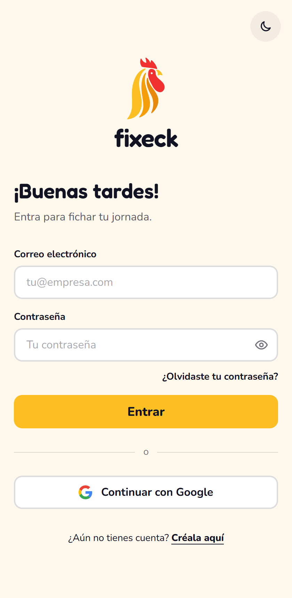
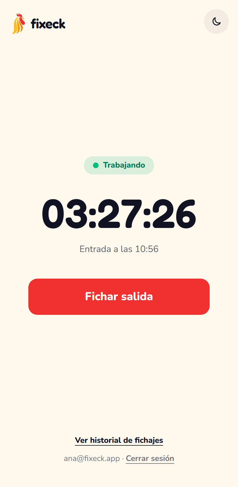
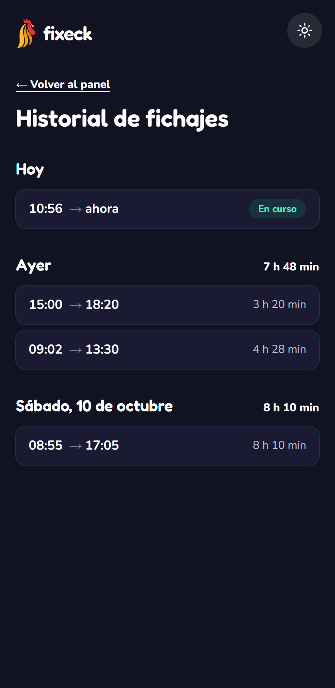
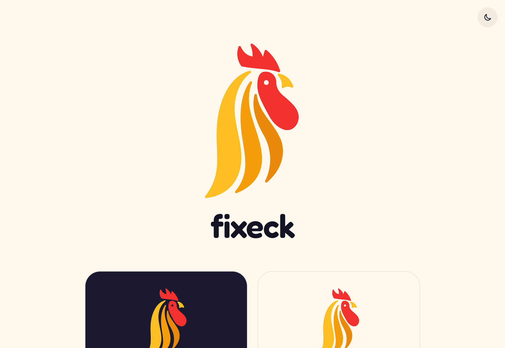

# Fixeck

Aplicación web de control horario: los empleados fichan la entrada y la salida de su jornada, ven el tiempo trabajado en tiempo real y consultan su historial.

El nombre une **fixar** (en valenciano, fijar o dejar constancia) y **check** (el gesto de marcar algo como hecho). La mascota es un gallo, el reloj más antiguo que existe.

**Demo:** https://fichet-2d167.web.app · **Identidad de marca:** https://fichet-2d167.web.app/marca

| Acceso | Panel | Historial |
| :---: | :---: | :---: |
|  |  |  |



## Funcionalidades

- **Acceso**: registro e inicio de sesión con correo y contraseña o con Google, y recuperación de contraseña por correo.
- **Panel**: estado de la jornada (trabajando o fuera de jornada), un único botón para fichar entrada o salida y un contador en tiempo real.
- **Historial**: las jornadas agrupadas por día, con sus horas, su duración y el total diario.
- **Tiempo real**: si se ficha desde otro dispositivo, el panel y el historial se actualizan solos.
- **Hora del servidor**: las horas de los fichajes las pone Firebase, no el reloj del dispositivo, y el contador se corrige si ese reloj va mal.
- **Modo claro y oscuro**, avisos emergentes con sonido y diseño adaptado a móvil y escritorio.

## Tecnologías

| Para qué | Con qué |
| --- | --- |
| Interfaz | Vue 3 (Composition API) y Vue Router |
| Estilos | Tailwind CSS 4 |
| Usuarios | Firebase Authentication |
| Datos | Cloud Firestore |
| Alojamiento | Firebase Hosting |
| Avisos | vue-sonner |
| Tests | Vitest y Vue Test Utils |
| Empaquetado | Vite |

## Puesta en marcha

Hace falta Node.js 24 o superior.

```bash
git clone https://github.com/4tucode/fixeck.git
cd fixeck
npm install
```

Copia `.env.example` como `.env` y rellénalo con la configuración de tu proyecto de Firebase (consola de Firebase → Configuración del proyecto → Tus apps).

Para que el acceso con Google y el correo de recuperación funcionen en local, añade `localhost` a los dominios autorizados del proyecto (Authentication → Configuración → Dominios autorizados). Después:

```bash
npm run dev
```

### Comandos

| Comando | Qué hace |
| --- | --- |
| `npm run dev` | Arranca la app en local |
| `npm test` | Ejecuta los tests |
| `npm run build` | Genera la versión de producción en `dist` |
| `npm run emulador` | Arranca los emuladores locales de Auth y Firestore |

### Trabajar sin tocar los datos reales

Con los emuladores se pueden crear usuarios y fichajes de prueba sin que lleguen al proyecto real. Necesitan la [CLI de Firebase](https://firebase.google.com/docs/cli) y Java.

1. En una terminal: `npm run emulador`
2. En el `.env`, pon `VITE_USE_EMULATORS=true`
3. En otra terminal: `npm run dev`

## Estructura del proyecto

```
src/
├── components/     Piezas de interfaz reutilizables (campos, botones, cabecera, logo)
├── composables/    Lógica con estado de Vue: sesión, jornada en curso, historial, cronómetro, tema
├── utils/          Funciones sin estado: formato de horas, agrupar jornadas, avisos, sonidos
├── views/          Una vista por pantalla
├── router/         Rutas y protección de las pantallas privadas
└── firebase.js     Conexión con Firebase
```

Los tests están junto al código que prueban, en carpetas `__tests__`.

## Datos y seguridad

Cada jornada es un documento en `users/{uid}/shifts`:

| Campo | Tipo | Descripción |
| --- | --- | --- |
| `startedAt` | fecha | Hora de entrada. La pone el servidor. |
| `endedAt` | fecha o `null` | Hora de salida; `null` mientras la jornada sigue abierta. |

Las reglas de `firestore.rules` garantizan que:

- cada empleado solo puede leer y escribir sus propias jornadas;
- las horas de entrada y de salida son siempre las del servidor, no se pueden inventar;
- una jornada cerrada no se puede modificar, y ninguna se puede borrar.

## Despliegue

```bash
npm run build
firebase deploy
```

## Desarrollo asistido por IA

Este proyecto se ha desarrollado con Claude Code como copiloto de programación, de forma deliberada y transparente: es la manera de trabajar que hoy se encuentra en muchos equipos. Las decisiones de producto, la revisión y la validación de cada fase son del autor.
